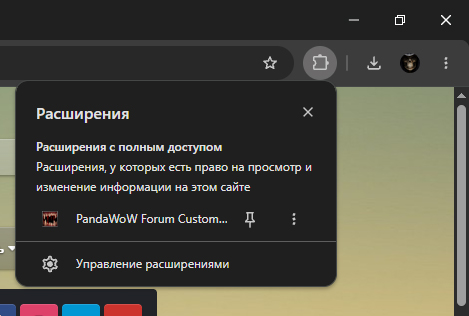
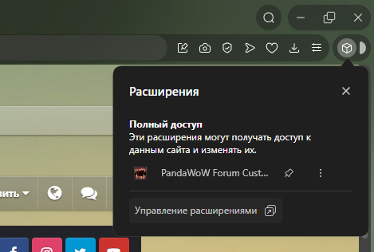
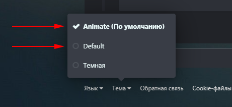
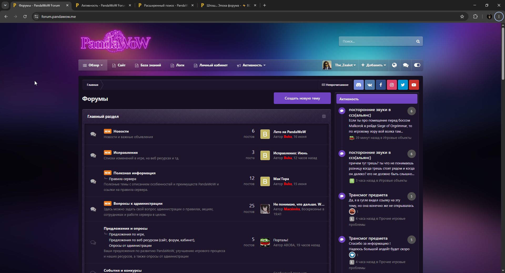
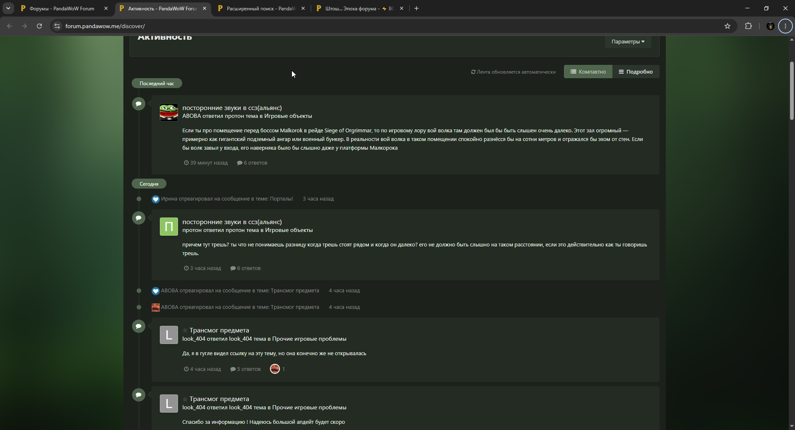
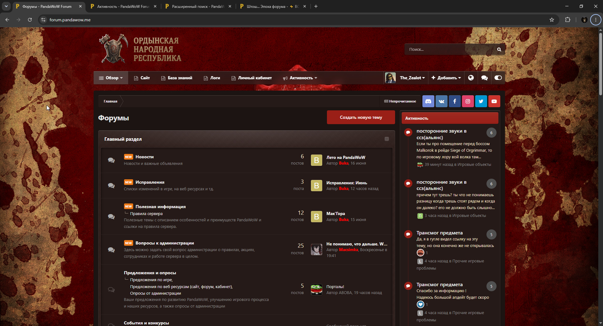
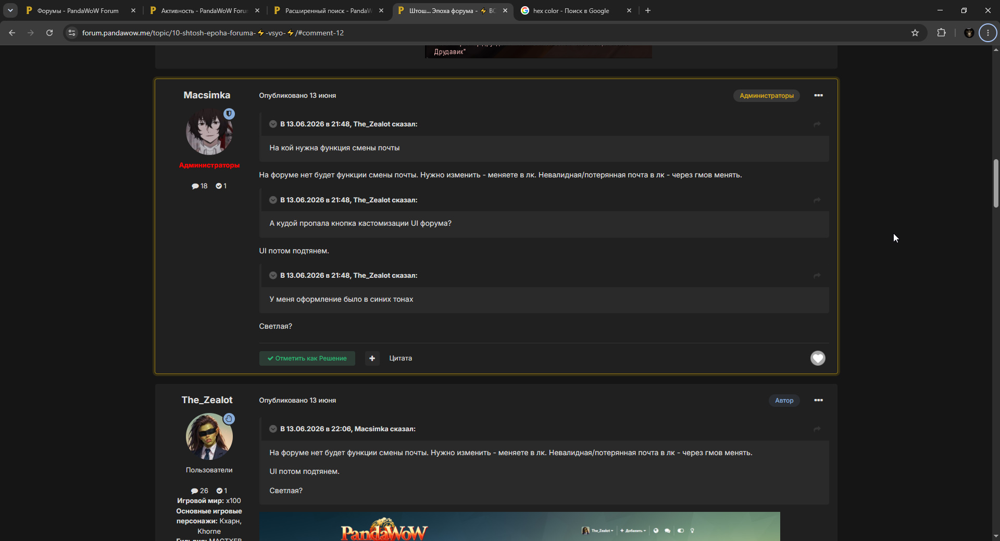
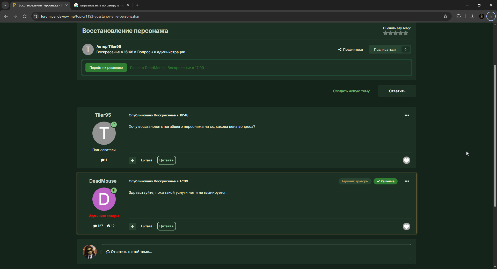

# Расширение браузера для кастомизации форума PandaWoW

## Установка

Качаем архив. Распаковываем в удобное место. В браузере заходим в раздел Расширения (Extensions). Обязательно включаем режим разработчика. 
Нажимаем кнопку "Загрузить распакованное расширение" и выбираем папку, которую распаковали ранее, в которой лежит файл manifest.json.

Профит!

## Как пользоваться

### Внешний вид / Темы форума

Нажимаем на иконку расширений в панели браузера (для Google Chrome и Microsoft Edge - пазл в правом верхнем углу, для Opera - куб и т.д.).
Выбираем наше расширение PandaWoW Forum Customizer. В появившейся форме выбираем любую понравившеюся тему. 

| Google Chrome | Opera |
| :---: | :---: |
|  |  |

> Важно!!!
> Темы делятся на 2 типа Animate и Default. Чтобы они работали корректно, у Вас должна быть выбрана одноименная тема форума.
> Выбрать её можно, прокрутив страницу в самый низ, нажать на кнопку "Тема" и в появившемся контекстном меню выбрать нужный вариант.

	

### Дополнительная функциональность

Расширение добавляет кнопку прокручивания страницы вверх, а также возможность цитировать сообщения из закрытых тредов, добавляя на каждое сообщение кнопку "Цитата+". При таком цитировании сообщение полностью помещается в локальное хранилище браузера. Чтобы его использовать, необходимо в открытом треде, в редакторе ответа, нажать новую кнопку "Вставить".

Примеры кастомных тем:

	<b>Animate</b>  
	  
	  
	

	<b>Default</b>  
	  
	

